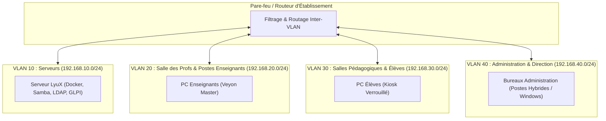
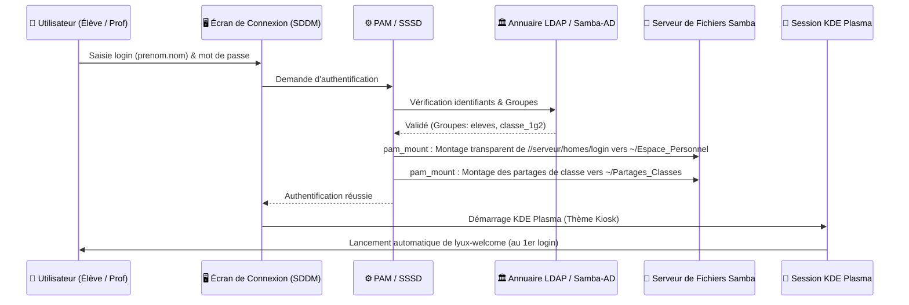

# 🏛️ Architecture Technique Détaillée — Système LyuX

Ce document décrit en profondeur les flux de données, la sécurité, l'authentification et l'architecture réseau du projet **Opération Manchot (LyuX)**.

---

## 1. Schéma des Flux et Découpage Réseau

Pour garantir la sécurité et la séparation des usages dans un lycée, le réseau est segmenté en **VLANs** distincts :

---

## 2. Cycle d'Authentification et Montage Réseau (`SSSD` + `pam_mount`)

Lorsqu'un utilisateur ouvre sa session sur n'importe quel poste du parc :

---

## 3. Verrouillage du Bureau : KDE Kiosk

Le système **KDE Kiosk** permet de figer l'environnement de bureau pour que chaque élève retrouve un poste propre et uniforme :
* **Barre des tâches fixe** : impossibilité de supprimer le menu ou les raccourcis essentiels.
* **Panneau de configuration restreint** : accès refusé aux réglages réseau, à la gestion des utilisateurs et aux services système.
* **Nettoyage automatique** : à la déconnexion ou à l'extinction, les fichiers temporaires locaux de `/tmp` et les caches applicatifs sont nettoyés pour préserver les performances du disque local.

---

## 4. Serveur Unique All-in-One & Postes Universels

L'infrastructure serveur et client LyuX est documentée à plusieurs niveaux :

* **[Architecture Serveur Unique](https://github.com/Luux-Manchot/.github/blob/main/docs/PROJECT.md)** : socle Debian 12 natif (Samba-AD, partages, Cockpit sur 9090) + conteneurs Docker (MariaDB, GLPI, LAM, Uptime Kuma, Apt-Cacher, API Hub et `lyux-hub`).
* **[Admin panel : Cockpit natif + Hub conteneurisé](admin-panel-docker.md)** : périmètre de `lyux-hub`, shims Cockpit et points de vigilance.
* **[Couleurs et états du panneau d'administration](admin-ui-couleurs-etats.md)** : signification des couleurs du prototype React et lecture de la répartition du parc.
* **[Stratégie de test & lab virtuel](https://github.com/Luux-Manchot/.github/blob/main/docs/TEST_INFRA.md)** : VMs pilotées en SSH et validées par la suite de tests automatisés.

---

## 5. Versions, paquets et mises à jour (en conception)

Le serveur doit devenir la source de vérité des versions de l'OS, des logiciels et du client LyuX. L'API expose déjà des routes de télémétrie et de versions, mais elles reposent sur des données en mémoire : les endpoints `system/updates/check`, `system/updates/apply` et `client/update-manifest` sont des stubs et aucun artefact n'est stocké ni signé. `apt-cacher-ng` n'est qu'un cache de paquets, pas un dépôt signé.

L'orientation retenue pour le travail à venir est décrite dans l'**ADR-019** (`.antigravity/memory/decisions.md`) : registre persistant des versions, artefacts sur volume dédié, manifeste signé Ed25519 avec empreintes SHA-256, distribution par `lyux-api` derrière `lyux-hub`, distinction entre détection, distribution et application, puis politiques par salle avec fenêtre de maintenance et retour arrière. Quatre points restent à trancher avant implémentation : le format de Fastpack, le périmètre exact de la mise à jour OS, l'accès Internet ou LAN, et le caractère automatique ou validé des mises à jour. La piste de détection des versions et d'ajout réel au catalogue est détaillée dans [`catalogue-logiciels-detection.md`](catalogue-logiciels-detection.md).

Cette évolution ne modifie ni le rôle de Cockpit pour l'administration système (ADR-017), ni le caractère visuel du prototype React (ADR-018). Le prototype contient déjà une page `/paquets/` qui présente le registre, le manifeste signé et la politique de mise à jour avec des données simulées ; elle n'effectue aucun appel à l'API. Elle consomme les besoins déjà listés dans les issues `lyux-server#9`, `#11`, `#12` et `#13` sans les dupliquer. Le suivi est assuré par les issues `#14` (décision), `#15` (interface) et `#16` (socle API).
