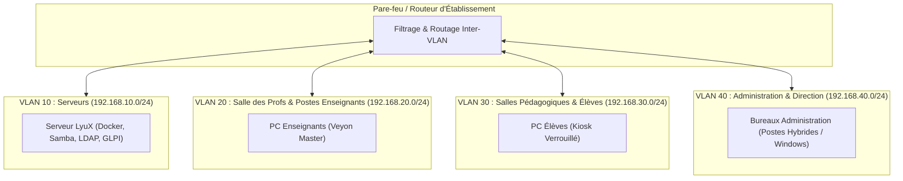
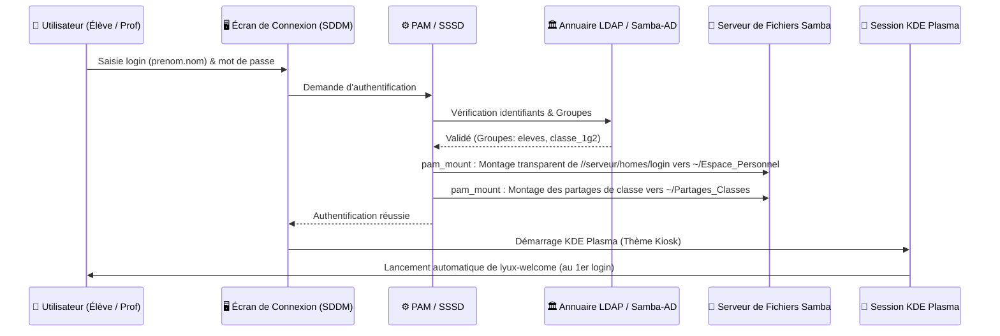

# 🏛️ Architecture Technique Détaillée — Système LyuX

Ce document décrit en profondeur les flux de données, la sécurité, l'authentification et l'architecture réseau du projet **Opération Manchot (LyuX)**.

---

## 1. Schéma des Flux et Découpage Réseau

Pour garantir la sécurité et la séparation des usages dans un lycée, le réseau est segmenté en **VLANs** distincts :

---

## 2. Cycle d'Authentification et Montage Réseau (`SSSD` + `pam_mount`)

Lorsqu'un utilisateur ouvre sa session sur n'importe quel poste du parc :

---

## 3. Verrouillage du Bureau : KDE Kiosk

Le système **KDE Kiosk** permet de figer l'environnement de bureau pour que chaque élève retrouve un poste propre et uniforme :
* **Barre des tâches fixe** : impossibilité de supprimer le menu ou les raccourcis essentiels.
* **Panneau de configuration restreint** : accès refusé aux réglages réseau, à la gestion des utilisateurs et aux services système.
* **Nettoyage automatique** : à la déconnexion ou à l'extinction, les fichiers temporaires locaux de `/tmp` et les caches applicatifs sont nettoyés pour préserver les performances du disque local.

---

## 4. Serveur Unique All-in-One & Postes Universels

L'infrastructure serveur et client LyuX est documentée dans le Wiki complet du projet :
* **[Architecture Serveur Unique](../wiki/Architecture-Serveur-Unique.md)** : Socle Debian 12 natif (Samba-AD, Partages, Cockpit) + Conteneurs Docker (MariaDB, GLPI, LAM, Uptime Kuma, Apt-Cacher, API Hub).
* **[Postes Universels & Rôles Dynamiques](../wiki/Postes-Universels-et-Roles-Dynamiques.md)** : Zéro distinction matérielle en salle. L'écran SDDM active le rôle Élève (Kiosk, 5 Go, Veyon Service) ou Enseignant (Supervision Veyon Master, 20 Go, gestion de classe).
* **[Stratégie de Test & Lab Virtuel SSH](../wiki/Strategie-de-Test-Lab-et-Automatisation-SSH.md)** : Déploiement en petites VMs pilotées à 100% en SSH et validées par la suite de tests automatisés.
